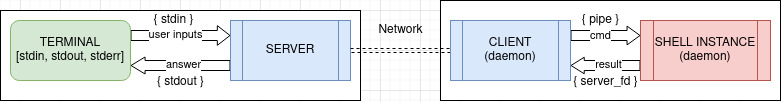
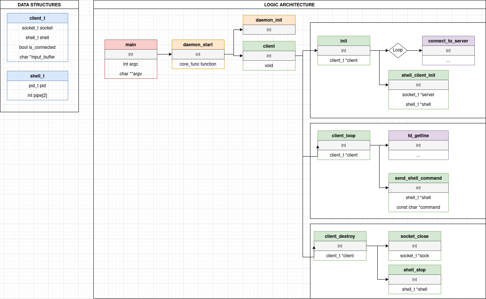
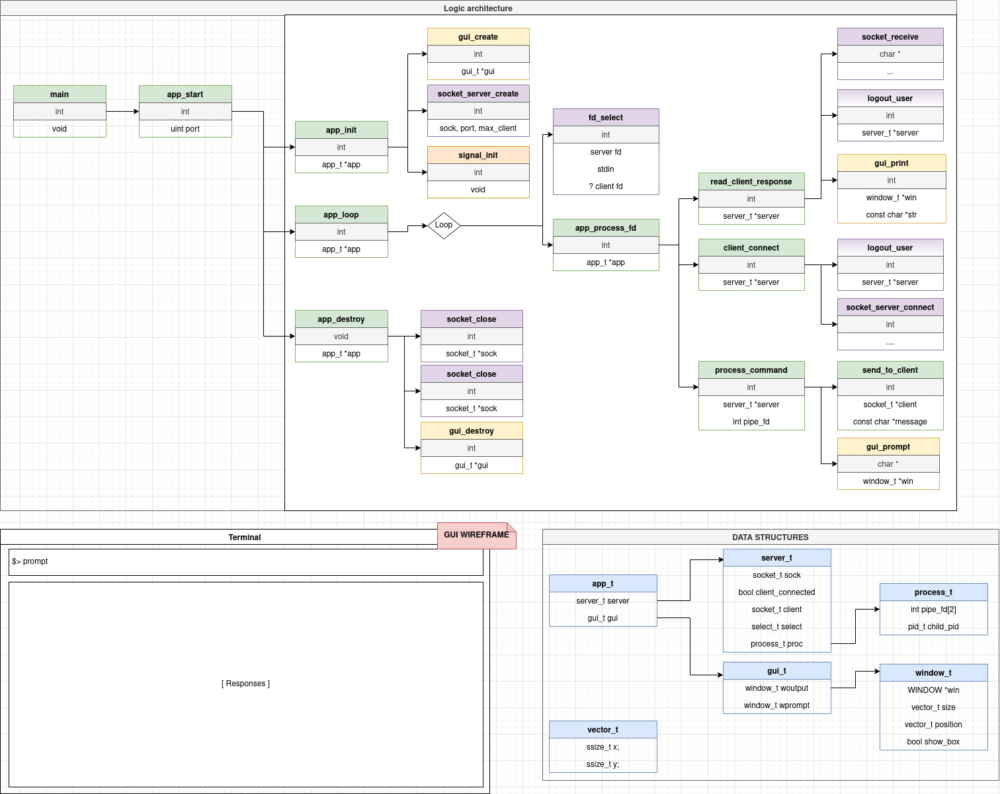

# Epitech Hub - Workshop - My_Trojan 04/2021
The goal of this project is to create a simple Trojan application (for science!) that demonstrates how a computer can be remotely controlled in a discreet manner, either over a local network or through the Internet.

## Usage
`$> cd server && make && ./my_troyan_cli`

`$> cd client && make && ./my_troyan`

Linux only

## Documentation

# Concept

# Client

# Server

